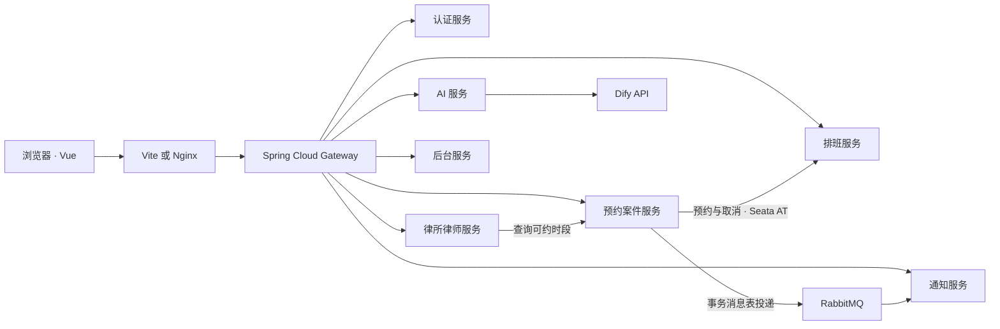

# 智能律所平台

面向公众、律师和平台管理员的法律服务平台。公众可以查询律所和律师，注册后可预约、咨询、查看案件、接收站内通知和使用智能法律助理。律师在工作台维护资料与排班，处理预约和咨询。管理员维护业务数据、查看统计与审计记录。

项目由 Vue 前端、Spring Cloud Gateway、7 个业务微服务和 Spring Boot Admin 监控服务组成。开发时可以用 IDEA 运行后端、用 Vite 运行前端，基础设施由 Docker 提供。也可以用 Docker Compose 运行整套系统。

- [快速启动](#快速启动)
- [功能与角色](#功能与角色)
- [架构与数据库](#架构与数据库)
- [核心业务与中间件](#核心业务与中间件)
- [API 概览](#api-概览)
- [验证与排查](#验证与排查)
- [仓库目录](#仓库目录)

## 快速启动

### 准备环境

- JDK 17，构建使用仓库自带的 Maven Wrapper。
- Node.js 20 和 npm，用于本地前端开发。全量 Compose 部署在镜像内构建前端。
- Docker Desktop 或 Docker Engine，以及 Docker Compose v2。首次构建需要下载 Maven 依赖、镜像和 Sentinel Dashboard JAR。
- 以下命令以 Windows PowerShell 为例。所有命令默认在仓库根目录执行。

```powershell
git clone https://github.com/DGKL05/smart-law-firm-agent.git
cd smart-law-firm-agent
```

首次运行时生成本地 `.env`。已有文件时沿用原来的凭据。OAuth2 内省密钥由认证服务、网关和各资源服务共用，必须为 32 至 72 字节。RabbitMQ 和 Spring Boot Admin 分别使用各自的登录密码。

```powershell
if (-not (Test-Path .env)) {
    $rng = [Security.Cryptography.RandomNumberGenerator]::Create()
    try {
        $keys = 'OAUTH2_INTROSPECTION_CLIENT_SECRET', 'RABBITMQ_PASSWORD', 'SBA_PASSWORD', 'INTERNAL_SERVICE_TOKEN'
        $keys | ForEach-Object {
            $bytes = New-Object byte[] 32
            $rng.GetBytes($bytes)
            "$_=$([Convert]::ToBase64String($bytes))"
        } | Set-Content .env -Encoding ascii
    } finally {
        $rng.Dispose()
    }
}
```

### 方式一 · Docker 中间件 + IDEA 后端 + Vite 前端

1. 构建监控服务，启动基础设施。

   ```powershell
   .\mvnw.cmd -pl monitor-service -am -DskipTests package
   docker compose up -d --build mysql redis mongodb nacos nacos-config-init rabbitmq seata-server sentinel-dashboard zipkin monitor-service
   docker compose ps -a
   ```

   MySQL 初次启动会创建并初始化 7 个业务库。Nacos 健康后，`nacos-config-init` 发布缺失配置。该任务执行成功后以退出码 0 结束。复用旧数据卷时，先备份并执行 [数据库升级脚本](sql/README.md)。

2. 在 IDEA 打开根目录的 `pom.xml`，将项目 SDK 设置为 JDK 17，完成 Maven 同步。在运行配置中选择 **`01-全部后端`**，启动网关和全部 7 个业务服务。也可从同一组运行配置单独启动或调试某个服务。项目根目录的 `.env` 由各服务启动配置读取。
3. 在 IDEA 的 Terminal 或系统终端启动前端。

   ```powershell
   cd frontend
   npm ci
   npm run dev
   ```

4. 打开 Vite 输出的地址，默认是 [http://localhost:5173](http://localhost:5173)。API 经 Vite 代理访问本机 `8080` 端口的网关。本地认证预登记 `5173` 和 `5174` 的回调，包含 `localhost` 与 `127.0.0.1`。使用其他端口时，将完整的 `/oauth/callback` 地址填入 `OAUTH2_REDIRECT_URIS`，多个地址用逗号分隔，然后重启认证服务。

### 方式二 · Docker Compose 全量部署

切换前先停止 IDEA 后端和 Vite，释放网关与前端端口。两种方式使用独立的 Nacos 服务发现分组，共用业务库。

```powershell
.\mvnw.cmd -DskipTests package
docker compose up -d --build
docker compose ps -a
```

前端镜像在 Node 构建阶段打包页面，由 Nginx 提供静态文件并转发 API。后端镜像由根目录 [Dockerfile](Dockerfile) 复制各模块的 JAR。默认入口是 [http://localhost:5173](http://localhost:5173)，网关在本机 `8080` 端口。可在 `.env` 中调整 `FRONTEND_HOST_PORT` 和 `GATEWAY_HOST_PORT`。Compose 会根据前端端口设置认证签发者和回调地址。

`docker compose down` 停止整套环境并保留命名数据卷。`docker compose down -v` 会删除 MySQL、RabbitMQ、Seata 和 MongoDB 的命名数据卷。已有数据时，先备份再执行数据库升级或凭据变更。MySQL 和 RabbitMQ 的初始化凭据对新数据卷生效，已有实例的密码须在服务端一并更新。

### 演示账号

以下账号来自 [演示数据脚本](sql/microservices/999_init_data.sql)，用于本地开发和演示。对外部署前应更换演示密码、数据库凭据与内部服务令牌。Compose 默认只向本机发布端口，Nacos 在本地配置下关闭鉴权。

| 角色 | 用户名 | 初始密码 | 登录后入口 |
| --- | --- | --- | --- |
| 管理员 | `admin` | `123456` | 管理后台 |
| 普通用户 | `user` | `123456` | 用户中心 |
| 律师 | `lawyer` | `123456` | 律师工作台 |

### 启用智能法律助理

在项目根目录的 `.env` 或 AI 服务运行环境中设置 `DIFY_API_KEY`。自建 Dify 时同时设置 `DIFY_BASE_URL`，如 `https://dify.example.com/v1`。默认 API 地址为 `https://api.dify.ai/v1`。应用必须支持 `POST /chat-messages` 对话接口。凭据修改后重启 IDEA 的 AI 服务，或执行 `docker compose up -d ai-service` 使容器加载新配置。密钥仅供后端调用使用。

## 功能与角色

| 角色 | 页面与操作 |
| --- | --- |
| 访客 | 查看首页统计，按省份和关键词检索律所，按分类、律所和关键词检索律师，浏览档案、照片与预约日历 |
| 普通用户 | 注册、登录、更新资料和密码。选择时段预约，修改备注、取消或清理已取消的预约。查看本人案件、发起咨询、阅读和删除站内通知，使用 AI 助手管理会话 |
| 律师 | 维护本人资料和头像，维护周排班与临时停诊，查看和取消本人接办的预约，回复已分配的咨询 |
| 管理员 | 管理用户、角色、律所、律师、咨询、案件、预约、排班、停诊、通知、通知模板和审计。可上传律所照片与律师头像，查看跨服务统计 |

- 后台新增和编辑记录时，用户、律师、律所等关联项使用可搜索的下拉框，列表优先展示关联名称。编号仍用于标识记录。
- 图片支持 JPEG、PNG，单张上限 2 MB。律师上传本人头像，管理员可维护律所照片和律师头像。图片保存在律所律师库，公开列表与详情均可显示。
- 注册用户默认获得 `USER` 角色。律师账号需分配 `LAWYER` 角色并绑定律师档案，管理员使用 `ADMIN` 角色。停用律师后会阻止新的预约，原有业务仍可处理。删除律师档案前应先停用并处理关联中的预约、案件和咨询。

## 架构与数据库

后端使用 Java 17、Spring Boot 3.3.6、Spring Cloud 2023.0.4、Spring Cloud Alibaba 2023.0.3.2 和 MyBatis-Plus 3.5.12。前端使用 Vue 3、Vite 6、Vue Router、Pinia 和 Element Plus。各模块版本以 [根 POM](pom.xml) 与 [前端依赖](frontend/package.json) 为准。



业务服务各自拥有独立数据库和表。7 个数据库部署在同一 MySQL 容器中。运行时通过 API 或消息跨服务协作，数据库字段中的跨服务关联 ID 用于引用资源。网关和监控服务是额外的基础设施模块。

| 模块 | 端口 | 数据库 | 主要数据与职责 |
| --- | ---: | --- | --- |
| `gateway-service` | 8080 | — | 统一入口、服务名路由、令牌内省、管理操作审计采集 |
| `auth-service` | 8081 | `smart_law_auth` | 用户、角色、授权客户端和 OAuth2 授权记录 |
| `lawyer-service` | 8082 | `smart_law_lawyer` | 律所、律师、图片文件和公开名录 |
| `appointment-service` | 8083 | `smart_law_appointment` | 预约、案件、咨询、待投递通知和 AT 回滚日志 |
| `ai-service` | 8084 | `smart_law_ai` | AI 会话、消息历史和锁校验记录 |
| `admin-service` | 8085 | `smart_law_admin` | 管理审计、各业务服务的汇总统计 |
| `schedule-service` | 8086 | `smart_law_schedule` | 每周规则、临时停诊、时段占用和 AT 回滚日志 |
| `notification-service` | 8087 | `smart_law_notification` | 站内通知、已读状态、通知模板和事件去重 |
| `monitor-service` | 8090 | — | Spring Boot Admin 服务端，监控 Java 应用状态和指标 |
| `smart-law-common` | — | — | 通用响应、参数校验、异常处理、请求认证和 Feign 配置 |

表中的应用端口用于 IDEA 或容器网络内访问。全量 Compose 模式只将网关、前端和基础设施的指定端口映射到宿主机。

## 核心业务与中间件

### 统一认证与服务调用

浏览器以 `smart-law-spa` 客户端通过 OAuth2 授权码和 PKCE 登录。Spring Authorization Server 将客户端和授权记录持久化到 MySQL，签发有效期为 1 小时的不透明访问令牌。网关对令牌做内省并按当前角色校验权限。业务服务还会检查记录归属，限制用户或律师访问他人数据。改密、停用和退出可撤销对应的登录凭证。

网关按路由表将各路径转发到 `lb://服务名`，再从 Nacos 发现可用实例。OpenFeign 按服务名调用内部接口。预约服务的 Feign 客户端配置了 1500 ms 连接超时、3000 ms 读取超时和 `BASIC` 日志级别。业务内部接口使用内部服务令牌，令牌内省使用专用客户端凭据。 [网关路由配置](config/nacos/gateway-service.yml) · [预约服务配置](config/nacos/appointment-service.yml)

### 排班、预约与 Seata AT

管理员在「每周排班」按姓名选择律师，可复制某天的时段并一次保存整周。保存时检查版本、时间重叠和有效预约。临时停诊可按律师筛选，并覆盖对应日期的周排班。

用户在律师详情的月历中选择未来 35 天范围内的可约时段。预约服务核对律师状态，排班服务处理时段占用，案件冲突、停诊或已被占用的时间无法预约。取消后释放时段。同一时段并发预约时，只有成功占用的请求能够确认。

预约写入与排班占用，以及预约取消与时段释放，分别由 Seata AT 全局事务协调。两个业务库都维护 `undo_log`。任一事务参与方失败时，已执行的数据库变更可回滚。预约相关通知在业务事务成功后再异步投递。

### Redis、Sentinel 与 Dify

- **目录缓存**在 Redis 中缓存律师与律所基础资料，默认有效期 120 秒。档案变更时更新缓存状态。可约时段仍实时查询，以反映预约、取消和停诊。
- **会话锁**使用 Redis 为同一个 AI 会话提供 120 秒租约。请求重叠时返回 `409`，提交回答前再次验证锁持有者。会话与消息历史由 MySQL 保存。
- **律师详情**使用 Sentinel 资源 `lawyer:public-detail`。默认每实例 30 QPS，同一律师 ID 每秒最多 5 次，并启用慢调用熔断。
- **AI 请求**使用 Sentinel 资源 `ai:dify-chat`。默认每实例最多 8 个同时调用，同一账号每 10 秒最多 3 次。上游异常达到阈值时进入 15 秒熔断窗口。规则在 [config/nacos](config/nacos) 的对应 JSON 中维护。

### RabbitMQ 通知

预约成功、预约取消和律师首次回复咨询时，预约服务在本地事务中写入通知待投递表。后台任务向 RabbitMQ 发布事件，通知服务按事件键去重，消费后创建用户可读的站内通知。

预约和咨询分别使用 `smart-law.notifications.appointment` 与 `smart-law.notifications.consultation` 队列。每个通知服务实例为每条队列配置一个消费者，预取上限为 8，突发消息可以排队等待消费。消费失败可按配置重试，坏消息或最终失败的消息进入对应的 `.dlq`。在 RabbitMQ 管理界面可观察 `Ready`、`Unacked` 和死信队列。

### 运行组件与入口

| Docker 组件 | 本机端口或入口 | 用途 |
| --- | --- | --- |
| MySQL 8.0 | `3307` | 7 个业务数据库 |
| Redis 7 | `6379` | 公开目录缓存和 AI 会话锁 |
| MongoDB 7 | `27017` | 预留文档存储，当前 AI 历史保存在 MySQL |
| Nacos 2.3.2 | [控制台](http://localhost:8848/nacos/)，客户端另用 `9848` | 注册发现、集中配置、Sentinel 规则 |
| RabbitMQ 4.1 | `5672`，[管理界面](http://localhost:15672) | 通知异步处理、去重和死信排查 |
| Seata 2.1.0 | `8091`，[控制台](http://localhost:7091) | AT 事务协调 |
| Sentinel 1.8.8 | [Dashboard](http://localhost:8070) | 查看律师详情和 AI 调用的治理数据 |
| Zipkin 3.4.3 | [链路查询](http://localhost:9411) | 接收网关、HTTP 服务和 Feign 链路 |
| Spring Boot Admin 3.3.6 | [监控界面](http://localhost:8090) | 查看各 Java 应用的健康状态与 Actuator 指标 |

RabbitMQ 和 Spring Boot Admin 默认用户名均为 `smartlaw`，分别使用 `RABBITMQ_PASSWORD` 和 `SBA_PASSWORD`。本地 Sentinel 和 Seata 控制台的默认用户名、密码分别均为 `sentinel` 和 `seata`。

课程考核列出的链路方案为 Sleuth + Zipkin。本项目基于 Spring Boot 3.3，通过 Micrometer Tracing 将链路上报到 Zipkin，运行指标由 Spring Boot Admin 展示。当前扩展功能为 Redis、RabbitMQ 和图片上传。图片使用业务库持久化，Dify 作为外部对话依赖。

### Nacos 配置与环境变量

配置默认发布到 `public` 命名空间、`SMART_LAW_DEV` 配置分组。网关和 7 个业务服务启动时都读取 `smart-law-shared.yml` 和各自的 `<服务名>.yml`。共享配置管理 Feign 默认参数、监控注册和链路采样。专属配置管理服务端口、数据源、路由、队列和限流资源等。IDEA 的默认发现分组为 `DEFAULT_GROUP`，Compose 为 `SMART_LAW_DOCKER`。在服务列表中可按对应分组核对 8 个注册项。

| 变量 | 用途 |
| --- | --- |
| `OAUTH2_INTROSPECTION_CLIENT_SECRET` | 认证、网关和各资源服务共享的内省密钥 |
| `OAUTH2_ISSUER`、`OAUTH2_REDIRECT_URIS` | 签发者地址和允许的完整回调。Compose 根据 `FRONTEND_HOST_PORT` 生成 |
| `INTERNAL_SERVICE_TOKEN` | 服务间调用内部接口的凭据 |
| `MYSQL_ROOT_PASSWORD`、`MYSQL_PASSWORD` | Compose 初始化 MySQL 的 root 密码，以及 IDEA 应用连接库的密码。自定义时让两端与实际数据库凭据一致 |
| `RABBITMQ_USERNAME`、`RABBITMQ_PASSWORD` | 本地 RabbitMQ 管理和消息连接凭据 |
| `SBA_USERNAME`、`SBA_PASSWORD` | Spring Boot Admin 登录和应用注册凭据 |
| `NACOS_CONFIG_NAMESPACE`、`NACOS_CONFIG_GROUP` | 自定义 Nacos 配置命名空间 ID 和分组 |
| `NACOS_DISCOVERY_GROUP`、`NACOS_DOCKER_DISCOVERY_GROUP` | IDEA 与 Compose 的服务发现分组 |
| `DIFY_BASE_URL`、`DIFY_API_KEY` | Dify 服务地址和 API 密钥 |
| `FRONTEND_HOST_PORT`、`GATEWAY_HOST_PORT` | Compose 对宿主机发布的前端和网关端口 |

首次启动只发布缺失的配置。需要把仓库中的模板覆盖到当前配置中心时，先备份控制台的自定义值，再执行下列命令。

```powershell
docker compose run --rm --no-deps -e NACOS_CONFIG_APPLY_CHANGES=true nacos-config-init
```

共享和专属 YAML 在应用启动时加载，更新后需要重启受影响的服务。律师和 AI 的 Sentinel 规则由 Nacos 数据源监听，可以动态生效。配置模板位于 [config/nacos](config/nacos)，本机密钥放在被 Git 忽略的 `.env` 中。

## API 概览

外部请求统一从前端代理或 `http://localhost:8080` 访问。受保护的接口携带 `Authorization: Bearer <access_token>`。业务 JSON 响应包含 `code`、`message`、`data`，分页数据包含 `records` 和 `total`。业务列表通常使用 `pageNum` 和 `pageSize`，具体筛选字段以对应控制器为准。OAuth2 端点使用标准 OAuth2 请求和响应，图片读取返回二进制内容。

下表中的 CRUD 包含列表和详情查询、创建、更新与删除。具体操作还受角色、数据归属和业务状态约束。

| 范围 | 路径 | 操作 |
| --- | --- | --- |
| OAuth2 | `/.well-known/oauth-authorization-server`、`/api/oauth2/{authorize,csrf,login,token}` | 元数据、授权、登录表单 CSRF、令牌交换 |
| 个人账号 | `/api/auth/register`、`/api/auth/me`、`/api/auth/password`、`/api/auth/logout` | 注册、查改资料、改密、退出 |
| 公开目录 | `/api/public/home/stats`、`/api/public/law-firms`、`/api/public/lawyers`、`/api/public/media/{id}` | 首页统计、列表和详情、查看图片 |
| 用户预约 | `/api/me/appointments` | 查询、`POST /book` 预约、更新备注、`PUT /{id}/cancel`、删除已取消或失败的记录 |
| 用户案件与咨询 | `/api/me/cases`、`/api/me/consultations` | 查询本人案件，创建和查询咨询，修改或删除尚未回复的咨询 |
| 用户通知 | `/api/me/notifications` | 查询、`PUT /{id}/read` 标为已读、删除 |
| 律师档案 | `/api/lawyer-center/profile`、`/api/lawyer-center/profile/avatar` | 查看和修改本人资料，上传头像 |
| 律师业务 | `/api/lawyer/{schedules,schedule-blocks,appointments,consultations}` | 排班与停诊 CRUD，查询和取消预约，查询和回复咨询 |
| AI | `/api/ai/sessions`、`/api/ai/chat` | 会话 CRUD、读取会话消息、发送对话 |
| 后台账号与档案 | `/api/admin/{users,roles,law-firms,lawyers}` | CRUD，另有律师 `/{id}/avatar` 和律所 `/{id}/photo` 上传接口 |
| 后台业务 | `/api/admin/{appointments,cases,consultations,schedules,schedule-blocks}` | CRUD、预约取消、咨询关闭。通过 `GET/PUT /api/admin/schedules/weekly?lawyerId={id}` 查询和保存整周 |
| 后台运营 | `/api/admin/{notifications,notification-templates,audit-events,stats}` | 通知、模板和人工审计 CRUD，查询汇总统计。网关自动采集的审计记录只读 |

花括号中的逗号分隔项表示各自独立的接口。上传接口使用 `multipart/form-data`，字段名为 `file`。整周排班更新须带上查询时返回的 `revision`，以及完整的 `rules` 列表。

## 验证与排查

### 构建与测试

```powershell
.\mvnw.cmd verify
docker compose config --quiet
npm --prefix frontend ci
npm --prefix frontend run build
```

用以下命令验证网关和公开接口。

```powershell
curl.exe -fsS http://localhost:8080/api/public/home/stats
curl.exe -fsS "http://localhost:8080/api/public/lawyers?pageNum=1&pageSize=2"
```

业务验收可按以下顺序进行。

1. 用普通用户、律师和管理员分别登录。核对各自的首页、权限和退出行为。
2. 在后台上传照片和头像，再在公开列表与详情中查看。用管理员选择律师并保存周排班，设置一次临时停诊。
3. 用普通用户在日历预约，验证同一时段无法重复占用。取消后确认时段恢复可约，并在消息中心查看预约与取消通知。
4. 由普通用户发起咨询、律师回复、管理员关闭，再查看咨询状态和站内通知。配置 Dify 后，在法律助理中发送消息并查看会话历史。
5. 在 Nacos 确认 8 个注册项，在 Spring Boot Admin 检查健康状态。在 Zipkin 查询律师详情请求跨越网关、律师、预约和排班服务的链路。

运行真实 Seata 回滚测试前，先按方式一启动基础设施并构建 JAR。脚本启动临时预约和排班进程，使用独立数据库验证预约、取消及失败后的回滚，结束后清理测试资源。需要 Python 3，默认使用本机 `18083` 和 `18086` 端口。

```powershell
.\mvnw.cmd -pl appointment-service,schedule-service -am -DskipTests package
python appointment-service/src/test/scripts/verify_seata_at.py --zipkin-endpoint http://127.0.0.1:9411/api/v2/spans
```

### 常见问题

| 现象 | 检查方法 |
| --- | --- |
| 打开 Nacos 的 `8848` 根路径返回 404 | 访问 [`/nacos/` 控制台](http://localhost:8848/nacos/)。打开服务列表和配置列表分别核对注册与配置 |
| Nacos 没有配置，或 Java 服务启动时报缺少配置 | 检查 `docker compose logs nacos-config-init`，核对配置命名空间与分组，再启动 Java 服务 |
| 只看到一部分微服务 | IDEA 运行 `01-全部后端`。在 Nacos 检查当前发现分组下是否有 8 个健康注册项 |
| OAuth2 授权失败或回调被拒绝 | 比对浏览器地址和 `OAUTH2_REDIRECT_URIS`，包括协议、主机名、端口和路径。认证升级或修改凭据后重新登录 |
| 没有找到业务表或 OAuth2 表 | 初始化脚本仅在数据卷首次初始化时运行。按 [SQL 升级说明](sql/README.md) 备份并执行增量 SQL |
| Docker 构建提示找不到后端 JAR | 在根目录先运行 `.\mvnw.cmd -DskipTests package`，再启动 Compose 构建 |
| Sentinel Dashboard 构建无法下载 JAR | 将 [对应版本的 Dashboard JAR](https://github.com/alibaba/Sentinel/releases/download/1.8.8/sentinel-dashboard-1.8.8.jar) 保存到 `docker/sentinel/sentinel-dashboard.jar`，在 `.env` 添加 `SENTINEL_DASHBOARD_SOURCE=sentinel-dashboard.jar` 后重建。镜像构建仍校验 SHA-256 |
| AI 页面提示未配置或暂不可用 | 检查 Dify 凭据、`/v1` API 地址和应用对话能力，然后查看 AI 服务日志以及 Sentinel 的限流、熔断状态 |
| 通知未到达 | 查看预约服务投递日志、RabbitMQ 队列和通知服务消费日志，留意对应的死信队列 |
| Zipkin 为空 | 先访问一次业务接口，检查应用的 Zipkin 上报地址和采样配置。本地 Zipkin 使用内存存储，重启后需产生新链路 |

## 仓库目录

| 路径 | 内容 |
| --- | --- |
| [pom.xml](pom.xml) | Maven 父工程、模块和后端依赖版本 |
| [frontend/](frontend) | Vue 页面、接口客户端、Vite 代理与 Nginx 镜像 |
| [各后端模块](#架构与数据库) | 业务控制器、领域逻辑、数据库访问、配置和测试 |
| [config/nacos/](config/nacos) | 共享和专属 YAML、Sentinel 规则、配置发布脚本 |
| [sql/microservices/](sql/microservices) | 各服务建库建表脚本、增量升级和演示数据 |
| [.run/](.run) | IDEA 后端一键启动与单服务运行配置 |
| [docker-compose.yml](docker-compose.yml) | 应用、基础设施、端口、依赖和数据卷编排 |
| [dify.md](dify.md) | Dify 对话接口参考 |
